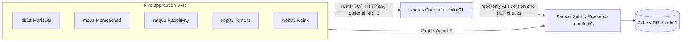

# Enterprise Infrastructure Monitoring with Nagios and Zabbix

Lecture Project 02 implementation (PDF pages 7–8) for the five existing Ubuntu application VMs. This repository manages a modular Nagios overlay and checks the already-shared Zabbix deployment owned by Project 2. It does not install a second Zabbix server.

## Architecture

The PDF diagram shows independent Nagios and Zabbix monitoring cores collecting from the same Linux hosts. Nagios Core, its plugin checks, NRPE, and its CGI frontend remain one stack; Zabbix Server, its database, frontend, agents, and optional SNMP polling remain another. A consolidated enterprise dashboard is optional and is not required for either stack to function.

This repository provides:

- Nagios active ICMP and TCP/HTTP checks for db01, mc01, rmq01, app01, and web01.
- Optional NRPE checks for CPU load, memory use, and root filesystem space.
- A read-only Zabbix API version check and TCP 10051 check from Nagios.
- A separate Project 2 Zabbix deployment for agent and SNMP telemetry, including network traffic counters.
- Example contact, email notification, and escalation objects. Notifications are disabled by default.

| Target | Address | Nagios check | What it proves |
| --- | --- | --- | --- |
| db01 | 192.168.56.12 | ICMP, TCP 3306, optional NRPE | Reachability and MariaDB port acceptance; no database login/query |
| mc01 | 192.168.56.13 | ICMP, TCP 11211, optional NRPE | Reachability and Memcached port acceptance; no cache command |
| rmq01 | 192.168.56.14 | ICMP, TCP 5672, optional NRPE | Reachability and AMQP listener acceptance; no queue or publish test |
| app01 | 192.168.56.15 | ICMP, TCP 8080, optional NRPE | Reachability and Tomcat listener acceptance; no VProfile deployment assumption |
| web01 | 192.168.56.16 | ICMP, HTTP response on port 80, optional NRPE | Nginx returns an HTTP response; no business transaction |

A successful TCP check means only that a TCP connection was accepted. The Nginx HTTP check verifies an HTTP response. Deeper service semantics require service-specific authenticated checks and credentials, which are intentionally not guessed or committed.

## Existing lab baseline and safe apply

Nagios Core 4.5.14 is already installed on monitor01 at 192.168.56.17. The playbooks never reinstall Nagios. They stage a candidate config, run Nagios validation before promotion, back up the active main config and any prior Project 1 directory, validate the promoted config, then restart. If promotion or validation fails, the playbook restores the saved files and validates the restored config.

The five target hosts are already registered in the known baseline. Therefore host object generation is disabled by default. Before applying, verify that the existing host object names are exactly db01, mc01, rmq01, app01, and web01. Set nagios_create_host_definitions=true only on a fresh Nagios install or after removing/merging duplicate host objects. The overlay uses distinct service descriptions to avoid silently replacing unrelated services.

Notifications are disabled by default and the contact address uses the reserved example.invalid domain. To enable notifications, configure a real operator address, confirm /usr/bin/mail and a working local mail transport, set nagios_notifications_enabled=true, then validate and review the change before applying.

## Layout

- inventory/lab.json: monitor and application VM addresses plus host roles and service ports.
- files/nagios/: modular Nagios commands, host/service groups, and escalation examples.
- files/nrpe/: fixed-argument NRPE checks with no remote command arguments enabled.
- files/plugins/: memory threshold and Zabbix API checks.
- templates/: inventory-driven host, service, and contact objects.
- playbooks/validate.yml: read-only validation of the active Nagios config.
- playbooks/apply.yml: backed-up, staged, validated Nagios overlay transaction.
- playbooks/configure-nrpe.yml: optional NRPE/plugin setup for the five app VMs.

## Setup and validation

1. Review the current hosts and object names on monitor01. Do not assume the web UI or prior host checks prove current health.
2. Set SSH access using LAB_SSH_USER or edit the inventory. Use the Vagrant-generated key path through Ansible's --private-key option; never copy the private key into this repository.
3. Run the read-only config validation:

        cd 01_Enterprise_Infrastructure_Monitoring_Nagios_Zabbix
        ansible-playbook playbooks/validate.yml --become

4. Review candidate rendering and resolve any duplicate object names before applying:

        ansible-playbook playbooks/apply.yml --become -e nagios_apply_confirmed=true

5. NRPE is optional and separately guarded:

        ansible-playbook playbooks/configure-nrpe.yml --become -e nrpe_apply_confirmed=true

   The Nagios overlay leaves NRPE service checks disabled by default. After the NRPE playbook succeeds, add them with:

        ansible-playbook playbooks/apply.yml --become -e nagios_apply_confirmed=true -e nagios_enable_nrpe_checks=true

6. Verify the Zabbix JSON-RPC endpoint from monitor01 and check NRPE from Nagios:

        /usr/local/nagios/libexec/p1-check-zabbix-api.py --url http://127.0.0.1/zabbix/api_jsonrpc.php
        /usr/local/nagios/bin/nagios -v /usr/local/nagios/etc/nagios.cfg

No command above was run against the VMs during file generation.

## Resource and network coverage

NRPE exposes fixed checks for load average (CPU pressure), memory utilization from MemAvailable, and root filesystem free space. The Project 2 Zabbix Linux agent template collects CPU, memory, filesystem, and network interface counters; SNMP polling on UDP 161 is an optional alternative for network devices or interfaces where agents are unsuitable. NRPE accepts connections only from monitor01 on TCP 5666. Zabbix passive agent checks use TCP 10050 and active agent traffic uses TCP 10051.

## Acceptance criteria

- Nagios validates the current and proposed config before a restart.
- All five application VMs are represented by host objects in the repository and grouped by service role.
- ICMP and required TCP/HTTP checks are assigned to the correct target.
- NRPE load, memory, and root disk checks work after the separately approved NRPE playbook is applied.
- The Nagios API check reports the API version only when the Zabbix frontend API responds.
- Zabbix CPU, memory, disk, filesystem, network, and time synchronization data comes from the shared Project 2 deployment.
- Notification behavior stays disabled until a real recipient and mail transport are configured.

## Engineering decisions and limits

The check thresholds are lab defaults, not production SLOs. NRPE is restricted to fixed commands with argument passing disabled. SNMP credentials are not included. Project 1 observes Zabbix by API and port checks; Project 2 owns Zabbix server, database, frontend, agent installation, templates, and auto-registration. The Zabbix database shares db01 with the monitored application as a lab trade-off and is not an HA design.
